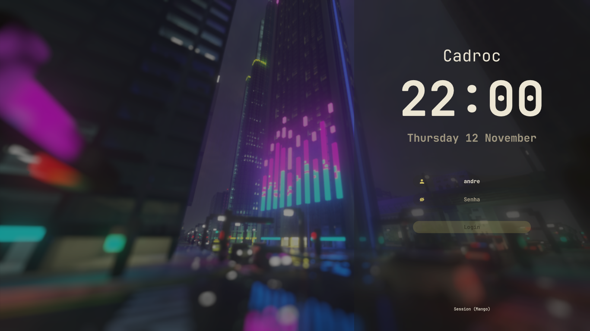

# sddm-cadroc-theme

Tema de login do Cadroc para o SDDM — Qt6/QML, responsivo, com a paleta do
sistema aplicada automaticamente.

Derivado do [sddm-astronaut-theme](https://github.com/Keyitdev/sddm-astronaut-theme),
com foco em legibilidade, integração com a paleta do Cadroc e instalação sem
quebrar o `/etc/sddm.conf`.



## O que muda em relação ao original

- **Cores do Cadroc**: o tema lê `~/.local/state/cadrocspace/sddm/theme.conf`,
  gerado pelo script `sddm-colors.sh` do Cadroc a partir do wallpaper. A paleta
  padrão do repositório é um fallback escuro e quente com contrastes medidos
  (13.6:1 texto/fundo, 10.2:1 texto do botão/accent, 6.1:1 texto secundário).
- **Responsivo**: sem largura/altura fixas, o tema ocupa o monitor inteiro
  (testado em 1366×768 e 1920×1080).
- **Indicador de layout de teclado**: mostra o layout atual (ex.:
  “Portuguese (Brazil)”) acima do campo de usuário, e só aparece quando há mais
  de um layout configurado.
- **Multi-monitor**: cada tela ganha sua própria janela do greeter, com o
  tamanho do monitor correspondente.
- **Instalador previsível**: instala via `rsync`, escreve um drop-in em
  `/etc/sddm.conf.d/`, faz backup da instalação anterior e não toca no
  `/etc/sddm.conf`.
- **Sem usuários indesejados**: `--hide-users a,b` grava `HideUsers` no drop-in.

## Dependências

- SDDM com greeter Qt6 (testado com `sddm 0.21` e Qt 6.12)
- `qt6-svg` e `qt6-multimedia`
- `qt6-virtualkeyboard` (opcional — sem ele o botão do teclado virtual não
  aparece)
- `ttf-jetbrains-mono-nerd` (fonte padrão; o Cadroc já a instala)
- `rsync` (recomendado; há fallback com `cp`)

No Arch:

```bash
./installer.sh --install-deps
```

## Instalação

```bash
git clone https://github.com/souandresouza/sddm-cadroc-theme.git
cd sddm-cadroc-theme
./installer.sh
```

O tema vai para `/usr/share/sddm/themes/sddm-cadroc-theme` e o SDDM passa a
usá-lo pelo drop-in `/etc/sddm.conf.d/10-cadroc-theme.conf`. Reexecutar o
instalador é seguro: a versão anterior é copiada para
`~/.cache/sddm-cadroc-theme/backups/<data>/`.

Para habilitar o SDDM como gerenciador de login:

```bash
./installer.sh --enable
```

## Testar sem sair da sessão

```bash
./installer.sh --test              # testa o tema deste repositório
./installer.sh --test-installed    # testa o tema instalado em /usr/share
```

Uma janela do greeter abre em cada monitor; feche-a para sair.

## Paleta do Cadroc

O Cadroc gera `~/.local/state/cadrocspace/sddm/theme.conf` quando a paleta do
wallpaper muda (`run-scripts.sh`). Para aplicar no tema instalado:

```bash
./installer.sh --recolor
# ou com um arquivo específico:
./installer.sh --recolor /caminho/theme.conf
```

Sem esse arquivo, o instalador mantém a paleta padrão do repositório.

## Outras opções

```bash
./installer.sh --wallpaper ~/imagens/fundo.png   # fundo da tela de login
./installer.sh --hide-users root,convidado       # oculta usuários da lista
./installer.sh --dry-run                         # mostra o que faria
./installer.sh --uninstall                       # remove tema e drop-in
./installer.sh --help
```

## Estrutura

```
.
├── Main.qml                 # janela do greeter
├── Components/              # formulário, relógio, campos, teclado virtual...
├── Themes/cadroc-default.conf  # paleta e comportamento padrão
├── Backgrounds/             # fundo padrão
├── Previews/screenshot.png  # prévia usada no README e no metadata
├── metadata.desktop         # metadados lidos pelo SDDM
└── installer.sh
```

## Licença

GPL-3.0-or-later. Veja [LICENSE](LICENSE). O tema é derivado do
sddm-astronaut-theme, também licenciado sob GPL-3.0-or-later.
